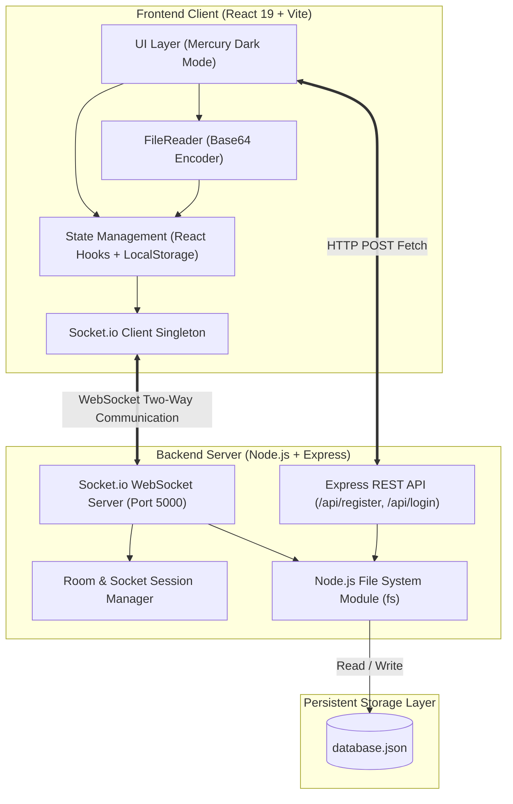
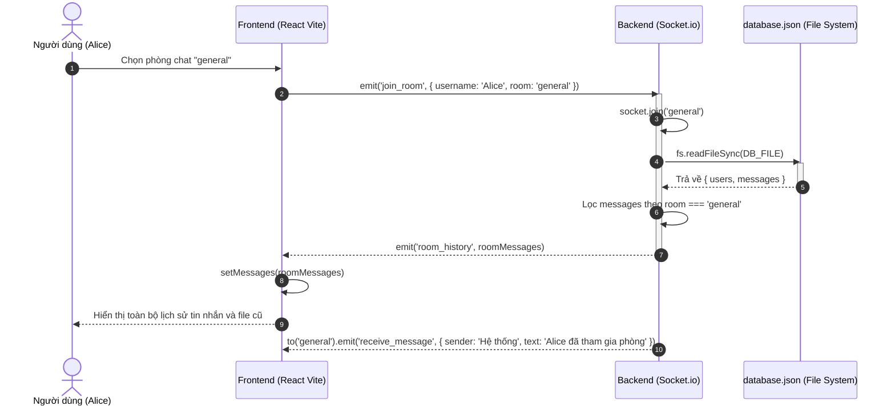
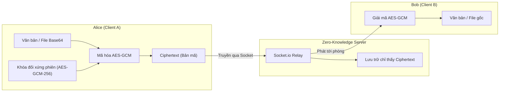

# Tài liệu Kiến trúc Kỹ thuật (Technical Architecture)

> **Dự án**: Mercury Messenger - Realtime Encrypted Chat System  
> **Phiên bản hiện tại**: Giai đoạn 1 (Realtime Messaging, Base64 File Transfer, JSON Storage)  
> **Định hướng tiếp theo**: Tích hợp Mã hóa Đầu cuối (End-to-End Encryption - E2EE)

---

## 1. Tổng quan Kiến trúc Hệ thống (System Overview)

Hệ thống được thiết kế theo mô hình **Client-Server phân tán thời gian thực**, bao gồm 3 tầng chính:



---

## 2. Luồng dữ liệu thời gian thực (Realtime Event Lifecycle)

### 2.1 Bảng ma trận sự kiện Socket.io (Socket Events Matrix)

| Tên sự kiện | Chiều truyền | Payload | Mục đích |
| :--- | :--- | :--- | :--- |
| `join_room` | Client $\rightarrow$ Server | `{ username: string, room: string }` | Thông báo client tham gia phòng; server thêm socket vào channel |
| `room_history` | Server $\rightarrow$ Client | `Message[]` | Trả về danh sách toàn bộ tin nhắn đã lưu của phòng đó cho client |
| `send_message` | Client $\rightarrow$ Server | `{ room, sender, text, attachment }` | Client gửi tin nhắn mới (kèm văn bản hoặc file Base64) |
| `receive_message`| Server $\rightarrow$ Room | `Message` | Broadcast tin nhắn vừa nhận cho toàn bộ thành viên trong phòng |
| `disconnect` | Socket Internal | *None* | Client mất kết nối hoặc đóng tab; broadcast thông báo rời phòng |

---

### 2.2 Sơ đồ tuần tự: Tham gia phòng & Nạp lịch sử (Join Room & History Hydration)



---

### 2.3 Sơ đồ tuần tự: Gửi tin nhắn & Tệp đính kèm Base64 (Send Message & File Flow)

```mermaid
sequenceDiagram
    autonumber
    actor Alice as Người gửi (Alice)
    participant ClientA as Frontend Alice
    participant FileReader as Browser FileReader
    participant Server as Backend Socket.io
    participant DB as database.json
    participant ClientB as Frontend Bob (Thành viên khác)
    actor Bob as Người nhận (Bob)

    Alice->>ClientA: Chọn tệp ảnh hoặc tài liệu
    ClientA->>FileReader: reader.readAsDataURL(file)
    activate FileReader
    FileReader-->>ClientA: reader.result (Chuỗi Base64: data:...;base64,...)
    deactivate FileReader
    ClientA-->>Alice: Hiển thị Preview Capsule (Tên, cỡ, thumbnail)

    Alice->>ClientA: Bấm nút "Gửi"
    ClientA->>ClientA: Clear state tệp & input text
    ClientA->>Server: emit('send_message', { room: 'general', sender: 'Alice', text, attachment })
    activate Server
    Server->>Server: Chuẩn hóa Message ID & Timestamp
    Server->>DB: fs.writeFileSync (Ghi tin nhắn mới vào mảng messages)
    Server-->>ClientA: io.to('general').emit('receive_message', message)
    Server-->>ClientB: io.to('general').emit('receive_message', message)
    deactivate Server

    ClientA-->>Alice: Render tin nhắn của mình (Bên phải, màu Indigo)
    ClientB-->>Bob: Render tin nhắn của Alice (Bên trái, màu Night-raised)
    alt Tệp là Hình ảnh (image/*)
        ClientB-->>Bob: Hiển thị thẻ  preview ảnh trực tiếp
    else Tệp tài liệu (PDF, Word...)
        ClientB-->>Bob: Hiển thị Card tải về với liên kết download={filename}
    end
```

---

## 3. Kiến trúc State phía Client (Frontend State Architecture)

Ứng dụng quản trị state theo cấp bậc phân tách rõ rệt:

```text
[App Component]
  │
  ├── currentUser (State): { id, username }
  │     └── Đồng bộ 2 chiều với localStorage ('mercury_chat_user')
  │
  ├── [Auth Component] (Khi currentUser === null)
  │     ├── isRegisterMode (Boolean): Chuyển tab Đăng nhập / Đăng ký
  │     ├── username, password, confirmPassword (String)
  │     └── loading, error, successMsg (UI Feedback)
  │
  └── [Chat Component] (Khi currentUser !== null)
        ├── room (State): 'general' | 'crypto-lab' | 'announcements'
        ├── isConnected (State): Theo dõi trạng thái Socket kết nối
        ├── messages (State): Mảng danh sách Message[]
        │     ├── [Header]: Điều hướng phòng, hiển thị trạng thái trực tuyến
        │     ├── [MessageList]: Auto-scroll to bottom, hiển thị tin nhắn & tệp
        │     └── [MessageInput]:
        │           ├── inputText (String)
        │           └── selectedAttachment (Object: { name, type, size, data })
```

### Cơ chế xử lý tệp tin Base64 ở Frontend:
1. **Lắng nghe sự kiện chọn tệp**: `<input type="file" onChange={handleFileChange} />`.
2. **Kiểm tra giới hạn**: Kiểm tra dung lượng tệp $\le 25\text{MB}$ để bảo đảm tính khả thi khi truyền qua mạng.
3. **Mã hóa không đồng bộ (Asynchronous Encoding)**:
   ```javascript
   const reader = new FileReader();
   reader.onload = () => {
     setSelectedAttachment({
       name: file.name,
       type: file.type || 'application/octet-stream',
       size: formatFileSize(file.size),
       data: reader.result, // Chuỗi Base64 hoàn chỉnh
     });
   };
   reader.readAsDataURL(file);
   ```
4. **Giải phóng bộ nhớ (State Cleanup)**: Ngay khi emit sự kiện `send_message`, biến `selectedAttachment` được gán về `null` và `fileInputRef.current.value = ''` để tránh rò rỉ bộ nhớ.

---

## 4. Kiến trúc Xử lý & Lưu trữ phía Server (Backend & Storage Architecture)

### 4.1 Cấu hình truyền tải dung lượng cao (High Buffer Capacity)
Mặc định Socket.io giới hạn gói tin ở mức $1\text{MB}$. Để cho phép truyền tệp hình ảnh và tài liệu qua chuỗi Base64 an toàn, máy chủ được cấu hình mở rộng bộ đệm:
```javascript
const io = new Server(server, {
  cors: { origin: '*', methods: ['GET', 'POST'] },
  maxHttpBufferSize: 1e8 // 100 MB
});
```

### 4.2 Cơ chế đọc/ghi bền vững qua File System (`fs`)
Hệ thống sử dụng các hàm đồng bộ an toàn có bọc `try...catch` để đảm bảo tệp JSON luôn ở trạng thái nguyên vẹn:
- `readDatabase()`: Kiểm tra sự tồn tại của `database.json`. Nếu chưa có, tự tạo cấu trúc rỗng `{ users: [], messages: [] }`. Sau đó phân tích cú pháp chuỗi JSON thành JavaScript Object.
- `writeDatabase(data)`: Ghi đè toàn bộ dữ liệu với định dạng thụt dòng 2 khoảng trắng (`JSON.stringify(data, null, 2)`), giúp dữ liệu dễ kiểm tra và debug.

---

## 5. Cấu trúc Mô hình Dữ liệu (Data Schemas)

### 5.1 User Model (Tài khoản người dùng)
```typescript
interface User {
  id: string;          // Ví dụ: "usr_1792842864142_h71e"
  username: string;    // Tên đăng nhập duy nhất (Case-insensitive check)
  password: string;    // Mật khẩu xác thực
  createdAt: string;   // Chuỗi thời gian ISO 8601
}
```

### 5.2 Attachment Model (Tệp đính kèm)
```typescript
interface Attachment {
  name: string;        // Tên tệp gốc: ví dụ "document.pdf", "avatar.png"
  type: string;        // MIME type: "image/png", "application/pdf", v.v.
  size: string;        // Dung lượng hiển thị thân thiện: "240.5 KB", "3.2 MB"
  data: string;        // Chuỗi Base64 Data URL (data:mime;base64,...)
}
```

### 5.3 Message Model (Tin nhắn chat)
```typescript
interface Message {
  id: string;                    // Ví dụ: "msg_1792842902755_vm22"
  room: string;                  // Phòng chat: "general", "crypto-lab"...
  sender: string;                // Username người gửi hoặc "Hệ thống"
  text: string;                  // Nội dung văn bản
  attachment: Attachment | null; // Tệp đính kèm Base64 (hoặc null nếu không có)
  timestamp: string;             // Định dạng hiển thị: "18:55", "06:55 PM"
  isSystem: boolean;             // true nếu là thông báo vào/rời phòng
}
```

---

## 6. Định hướng Kiến trúc Mã hóa Đầu cuối (E2EE Design & Future Phase)

Mục tiêu giai đoạn kế tiếp là chuyển đổi luồng truyền tin từ **Plaintext** sang **End-to-End Encryption** theo chuẩn công nghiệp **Hybrid Encryption**:



### Nguyên lý thiết kế:
1. **Trao đổi khóa bất đối xứng (RSA-OAEP / ECDH)**:
   - Mỗi người dùng tạo cặp khóa `Public Key` / `Private Key` bằng Web Crypto API trên trình duyệt.
   - `Public Key` được công khai lên server, `Private Key` lưu trữ an toàn trong `IndexedDB` của trình duyệt người dùng.
2. **Mã hóa nội dung đối xứng (AES-GCM 256-bit)**:
   - Bản thân tin nhắn văn bản và chuỗi Base64 của tệp đính kèm sẽ được mã hóa bằng khóa AES ngẫu nhiên.
   - Khóa AES được mã hóa bằng Public Key của người nhận và gửi kèm gói tin.
3. **Zero-Knowledge Server**:
   - Server và file `database.json` chỉ đóng vai trò kênh lưu trữ trung gian bản mã (`ciphertext`). Kẻ tấn công hoặc quản trị viên server không thể đọc được nội dung tin nhắn hay tệp dữ liệu.
