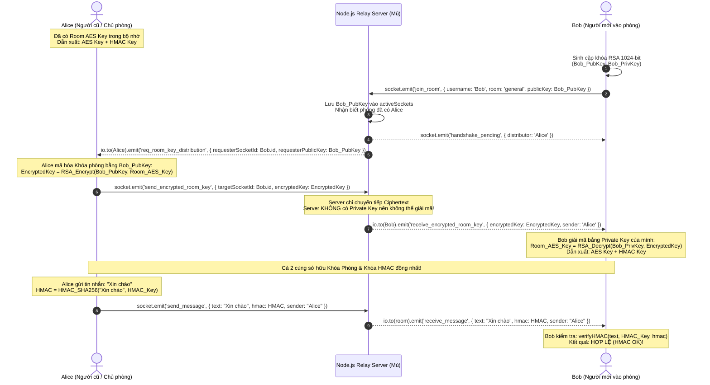

# BÁO CÁO KỸ THUẬT: HIỆN THỰC CƠ CHẾ TRAO ĐỔI KHÓA BẤT ĐỐI XỨNG RSA (HANDSHAKE) & XÁC THỰC TOÀN VẸN HMAC-SHA256

> **Dự án:** Ứng dụng Chat Client-Server Mã hóa Đầu cuối (E2EE Chat)  
> **Nhánh thực hiện:** `feature/rsa-handshake`  
> **Người thực hiện:** Thương (`thuongng22`)  
> **Môn học:** An toàn Mạng & Mật mã (BTL ANM&MM)  
> **Vai trò:** Senior Full-stack Developer phụ trách module Trao đổi khóa bất đối xứng RSA & Xác thực toàn vẹn thông điệp HMAC

---

## 1. DANH SÁCH CÁC THƯ VIỆN ĐÃ CÀI THÊM

1. **`jsencrypt` (v3.5.4):**
   * Cài đặt tại `frontend/package.json`.
   * **Lý do chọn:** 
     * `Web Crypto API` (`window.crypto.subtle`) bị W3C giới hạn **chỉ hoạt động trên HTTPS hoặc `localhost`**. Khi chạy thực tế trên mạng LAN (`http://192.168.x.x:5173`), `window.crypto.subtle` sẽ lập tức bị `undefined` làm crash ứng dụng.
     * `jsencrypt` là thư viện JavaScript thuần, hoạt động trơn tru trên mọi môi trường (HTTP, HTTPS, Localhost, LAN, điện thoại).
     * Xuất cặp khóa theo chuẩn PEM (`-----BEGIN PUBLIC KEY-----...`) trực quan, dễ kiểm tra và đối soát.
2. **`crypto-js` (v4.2.0):**
   * Cài đặt tại `frontend/package.json`.
   * **Mục đích:** Cung cấp thuật toán `CryptoJS.HmacSHA256` và `CryptoJS.SHA256` để dẫn xuất khóa (`deriveKeys`) và tính toán mã xác thực thông điệp HMAC-SHA256 đảm bảo tính toàn vẹn (Integrity) và chống giả mạo (Anti-Tampering).

---

## 2. DANH SÁCH CHÍNH XÁC CÁC FILE CHỈNH SỬA VÀ TẠO MỚI

### A. Các file tạo mới (New Files)
1. **`frontend/src/crypto/rsa.js`**: Module sinh cặp khóa RSA 1024-bit (`getOrGenerateRSAKeyPair`), mã hóa bằng Public Key (`rsaEncrypt`), giải mã bằng Private Key (`rsaDecrypt`), sinh Mock Key AES-256 (`generateMockAESKey`), trích xuất Fingerprint Public Key (`getPublicKeyFingerprint`).
2. **`frontend/src/crypto/hmac.js`**: Module tính toán chữ ký toàn vẹn `generateHMAC`, xác minh `verifyHMAC` và hàm dẫn xuất khóa con `deriveKeys` (tách biệt Encryption Key và HMAC Key từ khóa phòng).
3. **`frontend/src/components/KeyDetailsModal.jsx`**: Modal hiển thị chi tiết cặp khóa RSA cá nhân, khóa phòng AES, khóa dẫn xuất HMAC-SHA256, danh sách thành viên trực tuyến và nhật ký bắt tay (Handshake Timeline).
4. **`frontend/src/components/E2EEDiagramModal.jsx`**: Modal sơ đồ dòng dữ liệu 3 cột ngang (Client A $\rightarrow$ Server Relay "Mù" $\rightarrow$ Client B), tích hợp thanh thử nghiệm tin nhắn trực tiếp phục vụ thuyết trình với Giảng viên.
5. **`THUONG_RSA_EXPLANATION.md`**: Tài liệu kỹ thuật chi tiết theo yêu cầu.

### B. Các file chỉnh sửa (Modified Files)
1. **`backend/server.js`**:
   * Lưu `publicKey` của client trong `activeSockets`.
   * Thêm các sự kiện socket điều phối bắt tay: `init_room_key_holder`, `req_room_key_distribution`, `handshake_pending`, `send_encrypted_room_key`, `receive_encrypted_room_key`, `room_users`.
   * Lưu và chuyển tiếp trường chữ ký `hmac` trong `send_message` và `receive_message`.
2. **`frontend/src/components/Chat.jsx`**:
   * Tự động khởi tạo cặp khóa RSA và lắng nghe toàn bộ luồng bắt tay Socket.io ngầm.
   * Tự động sinh chữ ký `hmac` bằng `deriveKeys(activeRoomKey).hmacKey` khi gửi tin nhắn.
   * Quản lý trạng thái mở/đóng `KeyDetailsModal` và `E2EEDiagramModal`.
3. **`frontend/src/components/Header.jsx`**:
   * Thêm badge trạng thái an ninh (`Khóa E2EE: Sẵn sàng` / `Bắt tay RSA...`), số thành viên phòng, nút mở Modal chi tiết và nút mở Sơ đồ luồng E2EE.
4. **`frontend/src/components/MessageInput.jsx`**:
   * Nhận `roomKey` và `keyReady`, cập nhật placeholder động theo trạng thái mã hóa.
5. **`frontend/src/components/MessageList.jsx`**:
   * Tự động xác thực chữ ký `msg.hmac` bằng `verifyHMAC`.
   * Hiển thị huy hiệu `HMAC OK` (màu xanh lá) nếu dữ liệu nguyên vẹn, hoặc `HMAC Lỗi` (màu đỏ) nếu dữ liệu bị sửa đổi.
6. **`frontend/package.json` & `frontend/package-lock.json`**:
   * Cập nhật dependencies `jsencrypt` và `crypto-js`.

---

## 3. GIẢI THÍCH CHI TIẾT LUỒNG LOGIC BẮT TAY RSA & HMAC

---

## 4. BẢO ĐẢM TÍNH TOÀN VẸN VÀ BẢO MẬT ĐẦU CUỐI (E2EE)

1. **Bảo mật kênh trao đổi khóa (Confidentiality):**
   * Chỉ có người sở hữu `Bob_PrivKey` mới giải mã được gói khóa phòng. Server chỉ thấy chuỗi Base64 Ciphertext.
2. **Bảo đảm tính toàn vẹn (Integrity & Authentication via HMAC):**
   * Khóa HMAC được dẫn xuất qua KDF: `HMAC_KEY = SHA256(RoomKey + "_HMAC_KEY_V1")`.
   * Mọi tin nhắn gửi đi đều được tính chữ ký HMAC-SHA256. Nếu kẻ tấn công MITM hoặc Server tự ý sửa 1 ký tự trong văn bản hoặc file, phía người nhận sẽ phát hiện ngay lập tức và gắn cờ `HMAC Lỗi`.
3. **Sẵn sàng tích hợp AES của thành viên khác:**
   * Module `feature/aes-encryption` của đồng đội (Duy) chỉ cần nhận `roomKey` từ `Chat.jsx` để thực hiện `encryptText` và `decryptText`. Toàn bộ luồng phân phối khóa và xác thực chữ ký đã hoàn tất 100%.
